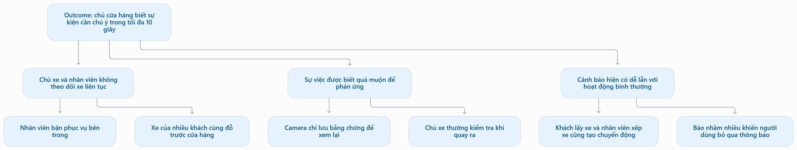
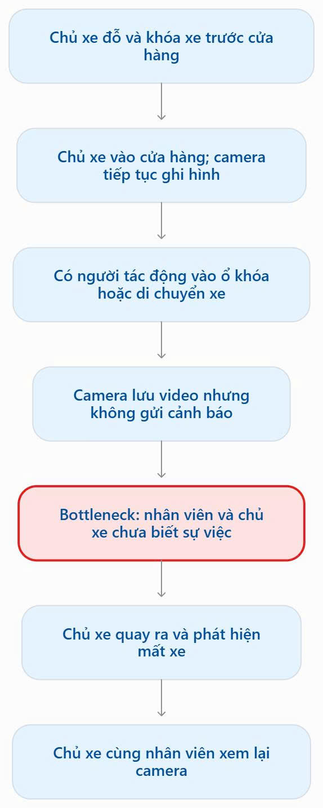
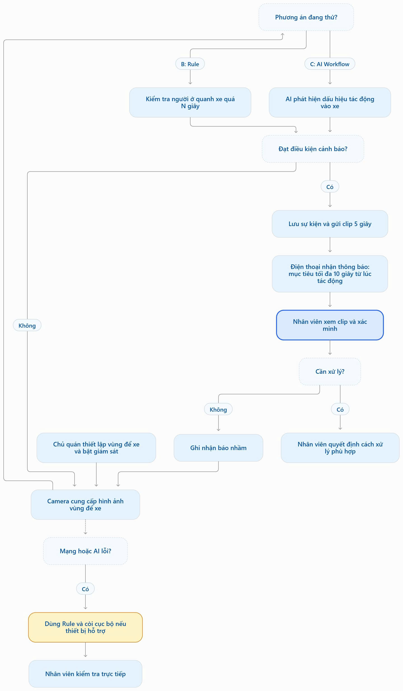

# Báo cáo nhóm — Day 02 Discovery & Problem Framing


## 1. Thông tin nhóm

- Tên nhóm: Nhomlo
- Thành viên: xem `TEAM.md`
- Candidate problem được chọn (1 câu): Xe máy để trước cửa hàng/nhà bị bẻ khóa lấy đi dù có camera, vì camera chỉ ghi hình mà không cảnh báo nên chủ xe chỉ biết khi đã mất.
- Quyết định cuối: **Not Yet** — thử Rule trước, chỉ thêm AI khi benchmark chứng minh tốt hơn rõ rệt

---

## 2. Hội tụ nhóm (CP3)

### 2.1. Pitch

| # | Người đưa ra | Candidate (Job Story ngắn) | Actor | Bottleneck | Câu hỏi phản biện nhận được (ai hỏi) |
|---:|---|---|---|---|---|
| 1 | Nguyễn Văn Quốc | Khi để xe máy trước cửa hàng/nhà mà không ai trông, tôi muốn được báo ngay lúc có người tác động vào khóa xe, để kịp ngăn thay vì quay ra mới biết mất xe | Người để xe; chủ/nhân viên cửa hàng | Camera chỉ ghi hình, không cảnh báo; biết sau ~60 phút | "Khác gì sản phẩm đang có?"; "Chỉ dùng rule-based có tốt hơn không?"; "Cảnh báo sai thì sao?"; "Cảnh báo nhầm có mất phí không?" (Nguyễn Tấn Châu hỏi) |
| 2 | Nguyễn Tấn Châu | Tự động soạn báo cáo tuần và gửi thông báo | Người quản lý dự án | Việc soạn báo cáo lặp lại hằng tuần, mất thời gian | Quốc hỏi: tác động thực sự, nhu cầu, chi phí, có thắng được baseline (một LLM cơ bản như Gemini/Claude) không? |
| 3 | Đào Văn Hiệp | Hiểu yêu cầu và thứ tự làm bài trên GitHub | Người học | Việc đọc hiểu yêu cầu, sắp thứ tự làm bài lặp lại, mất thời gian | Quốc hỏi: tác động thực sự, nhu cầu, chi phí, có thắng được baseline (một LLM cơ bản như Gemini/Claude) không? |

### 2.2. Cluster

| Cluster | Các candidate | Pattern chung |
|---|---|---|
| A | Cảnh báo mất trộm xe máy (Quốc) | An toàn tài sản ngoài đời thực: sự việc xảy ra trong vài giây, cần phát hiện kịp thời |
| B | Tự động soạn báo cáo tuần và gửi thông báo (Nguyễn Tấn Châu); hiểu yêu cầu và thứ tự làm bài trên GitHub (Đào Văn Hiệp) | Đọc, tổng hợp văn bản để hỗ trợ học tập/công việc — việc mà một LLM phổ thông đã làm tốt |

*Nhóm có 3 candidate nên không gom cluster chi tiết; nhóm phân tích từng card theo tác động, mức vượt baseline, chi phí và khả năng sinh lời.*

### 2.3. Opportunity Solution Tree rút gọn

Gốc là **1 outcome**. Nhánh là **opportunity** (nhu cầu, pain), không phải tính năng hay công cụ.

```text
OUTCOME: Giảm thời gian từ lúc xe bị tác động đến lúc có người biết, mà không làm phiền nhân viên bằng báo nhầm
├── Opportunity A: Camera của quán chỉ ghi hình, không ai theo dõi trực tiếp
├── Opportunity B: Cảnh báo "có người" trên camera có sẵn báo cả khách bình thường nên dễ bị tắt
└── Opportunity C: Khách để xe trước cửa không biết xe mình có ai trông, phần lớn không tự trang bị khóa có còi
     ✗ "Camera AI đọc cử chỉ"        ← solution, gạch khỏi tầng này
     ✗ "Thiết bị định vị gắn xe"      ← solution, gạch khỏi tầng này
```



Những ý đã gạch bỏ vì là solution đội lốt opportunity:

- "Camera AI đọc cử chỉ để phát hiện trộm" — là cách giải, không phải nỗi đau.
- "Thiết bị định vị / báo động gắn xe" — là sản phẩm đã có, đưa xuống phần research.

### 2.4. Chấm điểm shortlist (1–5)

Nhóm chấm theo tiêu chí nhóm tự thống nhất: mức tác động, tiết kiệm tiền, tiết kiệm thời gian, sự an toàn, chi phí vận hành, tính ứng dụng thực tiễn.

| Candidate | Điểm trung bình (1–5) trên 6 tiêu chí |
|---|---:|
| Cảnh báo mất trộm xe máy | **4.5** |
| Hiểu yêu cầu và thứ tự làm bài trên GitHub (Đào Văn Hiệp) | 4 |
| Tự động soạn báo cáo tuần và gửi thông báo (Nguyễn Tấn Châu) | 3 |

*Candidate yếu nhất được 3 điểm.*

**Candidate được chọn:** Cảnh báo mất trộm xe máy trước cửa hàng/nhà dù có camera.

**Vì sao chọn:** tác động trực tiếp đến tài sản và sự an toàn (một vụ mất xe ~20 triệu); có dấu hiệu thật; giải pháp không thể thay bằng việc hỏi một chatbot.

**Vì sao loại các candidate còn lại:** cả hai candidate (báo cáo tuần; hiểu yêu cầu bài trên GitHub) không thắng được baseline là một LLM cơ bản như Gemini hay Claude — người dùng chỉ cần dán nội dung vào chatbot là đã giải được phần lớn vấn đề.

**Xử lý bất đồng (nếu có):** ban đầu Nguyễn Tấn Châu và Đào Văn Hiệp chọn card của mình. Sau khi được hỏi về tác động thực sự, nhu cầu, chi phí và khả năng thắng baseline, hai bạn đồng ý chuyển sang bài toán cảnh báo mất xe.

---

## 3. Kiểm chứng + research giải pháp đã có (CP4)

### 3.1. Assumption Map

| # | Giả định | Loại (Value / Usability / Feasibility / Viability) | Quan trọng (1–5) | Đã có bằng chứng (1–5) | Kiểm chứng trước? |
|---:|---|---|---:|---:|---|
| 1 | Chủ cửa hàng có chỗ để xe cho khách đã từng gặp (hoặc lo ngại) mất xe của khách trước cửa | Value | 5 | 2 | ✅ |
| 2 | Chủ cửa hàng / người dùng camera hiện **không bật** hoặc **đã tắt** thông báo vì báo nhầm quá nhiều | Usability | 5 | 1 | ✅ |
| 3 | Rule có sẵn trên camera (vùng cảnh báo + lảng vảng quá N giây) báo nhầm nhiều ở cửa hàng đông khách ban ngày | Feasibility | 4 | 1 | ✅ |
| 4 | Cảnh báo trong ≤ 10 giây đủ để nhân viên ra ngăn hoặc còi làm kẻ trộm bỏ đi | Value | 4 | 2 | |
| 5 | Chủ cửa hàng chấp nhận trả thêm chi phí và chấp nhận quay vùng trước cửa (quyền riêng tư) | Viability | 3 | 1 | |


Giả định nhóm kiểm chứng trong buổi này: #1, #2, #3 (quan trọng cao, bằng chứng thấp).

### 3.2. Kiểm chứng

Cách đã dùng: Phỏng vấn (1 người)

| Trường | Nội dung |
|---|---|
| Người được hỏi (vai trò, không ghi tên thật) | Sinh viên cùng lớp (bạn cùng bàn) |
| Câu nói đáng nhớ nhất (nguyên văn) | Ý chính: ý tưởng hay, nhưng còn nhiều nút thắt rất khó giải quyết, như dữ liệu để huấn luyện model |
| Lần gần nhất gặp vấn đề này: chuyện gì đã xảy ra? | Chưa bị mất xe, nhưng đã thấy các vụ mất xe trên mạng |
| Hiện đang xử lý bằng cách nào (workaround)? | Đang dùng thiết bị định vị để bảo vệ xe |
| Mất bao lâu, bao lần? | Không áp dụng (chưa gặp trực tiếp) |
| Insight / opportunity rút ra | (1) Rủi ro lớn nằm ở dữ liệu: không có video trộm thật để huấn luyện/kiểm chứng AI. (2) Người lo mất xe đã tự trang bị định vị — giải pháp gắn xe có sẵn và đang được dùng |

Tổng hợp:

| Nguồn | Số người / số mẫu | Tín hiệu xác nhận | Tín hiệu phản bác |
|---|---:|---|---|
| Phỏng vấn bạn cùng lớp | 1 | Người được hỏi lo mất xe đến mức đã tự mua định vị (hành vi thật, không chỉ lời khen) | (1) Phản bác giả định "AI làm được với dữ liệu sẵn có": thiếu dữ liệu để huấn luyện model. (2) Người này đã có workaround (định vị gắn xe) → giá trị của nhóm phải nằm ở phía cửa hàng, cho khách chưa tự trang bị |
| Vụ mất xe thực tế (người quen) | 1 vụ + 3 người quen từng mất xe | Mất xe dù quán có bảo vệ và camera; chủ xe không dùng khóa đĩa vì tin vào bảo vệ và camera của quán | — |

**Hạn chế:** nhóm chưa phỏng vấn được người chịu tác động trực tiếp (chủ cửa hàng, người từng mất xe, khách hàng tiềm năng) do thiếu thời gian.

**Nhóm đã sửa problem thế nào sau kiểm chứng:** (1) đánh giá Feasibility ở mức Cao vì thiếu dữ liệu huấn luyện; (2) ưu tiên thử Rule có sẵn trên camera trước, AI chỉ thêm khi benchmark chứng minh; (3) đổi cách AI xử lý từ dự đoán nhãn "trộm / không trộm" sang theo dõi hành vi và gắn cờ mức độ rủi ro; (4) quyết định Not Yet, kiểm chứng với chủ cửa hàng trước.

### 3.3. Research giải pháp đã có

| Công cụ / case / pattern | Link | Giải bước nào trong quy trình? | Điểm mạnh | Khoảng trống / rủi ro | Bài học cho nhóm |
|---|---|---|---|---|---|
| Thiết bị định vị chống trộm gắn trên xe (Viettel Smart Motor) | [CellphoneS](https://cellphones.com.vn/thiet-bi-dinh-vi-xe-may-gps-viettel.html), [Mytour](https://mytour.vn/vi/blog/bai-viet/top-12-thiet-bi-chong-trom-hang-dau-hien-nay.html) | Bước phát hiện tác động + báo chủ xe: rung lắc/mở khóa trái phép → hú còi, nhắn tin/gọi chủ xe; tắt máy từ xa | Phản ứng ngay trên xe, không phụ thuộc camera | Chỉ bảo vệ xe đã tự lắp (~1,6–2 triệu); cửa hàng không bảo vệ được xe của khách | Phần "cảnh báo khi bị tác động" đã giải được ở phía chủ xe → giá trị của nhóm phải nằm ở phía **cửa hàng** |
| Báo động cảm biến rung giá rẻ | [Mytour](https://mytour.vn/vi/blog/bai-viet/top-12-thiet-bi-chong-trom-hang-dau-hien-nay.html) | Còi kêu khi xe bị rung lắc | Rất rẻ (~199–275 nghìn), dễ dùng | Phụ thuộc chủ xe tự trang bị; dễ kêu nhầm khi va chạm nhẹ | Là phương án **No AI** phải so sánh; chi phí giải pháp của nhóm phải đặt cạnh mức giá này |
| Camera wifi có AI phát hiện người (Imou, Ezviz…) | [Song Phương](https://songphuong.vn/cam-shop/), [Thế Giới Di Động](https://www.thegioididong.com/hoi-dap/top-camera-chong-trom-1563276) | Bước giám sát: phát hiện người/xe trong vùng tùy chỉnh, gửi thông báo, còi | Có sẵn, rẻ, chủ quán đã quen dùng | Chỉ biết "có người", không phân biệt khách lấy xe với kẻ bẻ khóa → báo nhầm ở nơi đông người | Baseline A trong benchmark: phải chứng minh tốt hơn cái đã có |
| Phát hiện lảng vảng (Loitering Detection) trên camera chuyên dụng | [Hikvision](https://enpinfo.hikvision.com/hkwsen/unzip/20230410194813_20373_doc/GUID-2582AB1E-B717-4103-AD7B-8C52F439664F.html), [IPCamTalk](https://www.ipcamtalk.com/goto/post?id=606521) | Báo động khi một người ở trong vùng quá thời gian cài đặt | Là **Rule** có sẵn, cấu hình được, không cần AI mới | Vẫn theo thời gian, không hiểu hành vi; người dùng vẫn lo báo nhầm | Baseline B (Rule): nếu đủ tốt thì nhóm dừng ở Rule |

**Kết luận research:**

```text
Phần "cảnh báo khi xe bị tác động" đã có sản phẩm làm được — nhưng ở phía CHỦ XE (thiết bị gắn xe).
Phía CỬA HÀNG đã có camera với phát hiện người và phát hiện lảng vảng (Rule), nhưng chưa phân biệt
khách lấy xe với người đang bẻ khóa → dễ báo nhầm ở nơi đông khách.
Hướng hợp lý: thử Rule có sẵn trên camera trước → chỉ thêm AI nhận dạng hành vi nếu benchmark
cho thấy giảm báo nhầm rõ rệt → nhân viên luôn xác nhận trước khi hành động.
```

Đây là điểm khác lớn nhất so với ý ban đầu ("AI đọc cử chỉ trong camera"): research cho thấy phải bắt đầu từ Rule, không phải từ AI.

---

## 4. Quy trình trước/sau (CP5)

### 4.1. Quy trình hiện tại

Sơ đồ (dựa trên vụ mất xe ngày 25/6/2025 trước một cửa hàng quần áo):

```text
HIỆN TẠI — 6 bước; kẻ trộm cần dưới 20 giây, chủ xe ~60 phút sau mới biết

[1 Khách dắt xe để trước cửa hàng, khóa cổ: 1'] → [2 Khách vào mua hàng: ~60'; quán có bảo vệ, camera chỉ ghi hình]
→ [3 Kẻ trộm bẻ khóa: dưới 20 giây; bảo vệ không thấy, camera không cảnh báo] ← BOTTLENECK
→ [4 Kẻ trộm chạy xe đi: không rõ] → [5 Khách quay ra mới phát hiện mất xe]
→ [6 Nhờ quán trích xuất camera, trình báo công an: không rõ]
```



| Bước | Actor | Input | Output | Thời gian / tần suất | Ghi chú |
|---:|---|---|---|---|---|
| 1 | Khách (chủ xe) | Xe, khóa cổ | Xe đỗ trước cửa | ~1 phút | Không có người trông xe |
| 2 | Khách; bảo vệ và camera của quán | Hình ảnh trước cửa | Video lưu trong đầu ghi/thẻ nhớ | ~1 giờ (vụ thực tế) | Bảo vệ không quan sát được hết mọi người; camera không có chức năng cảnh báo |
| 3 | Kẻ trộm | Xe đang khóa | Khóa bị phá | Dưới 20 giây (báo chí ghi nhận một vụ) | 🔴 **Bottleneck**: không ai biết lúc này |
| 4 | Kẻ trộm | Xe đã phá khóa | Xe bị lấy đi | Không rõ | — |
| 5 | Khách | Quay ra chỗ để xe | Phát hiện mất xe | ~1 giờ sau khi bị tác động | Handoff: khách báo chủ quán |
| 6 | Chủ quán; khách; công an | Video camera | Đoạn trích xuất, đơn trình báo | Không rõ | Video chỉ dùng được sau sự việc |

**Bottleneck chính:** bước 3 — bảo vệ không thể quan sát hết mọi người xung quanh, camera chỉ ghi hình và không cảnh báo, nên từ lúc bị tác động đến lúc có người biết mất khoảng 1 giờ, trong khi kẻ trộm chỉ cần dưới 20 giây.

### 4.2. Quy trình tương lai

Ghi rõ bước nào **Rule**, bước nào **AI**, bước nào **con người**, **boundary** ở đâu, **phương án quay về** khi AI sai.

```text
TƯƠNG LAI — 5 bước; mục tiêu nhân viên biết trong ≤ 10 giây; 1 bước thủ công

[1 Camera của quán giám sát vùng để xe: liên tục]                   ← có sẵn
→ [2 Có người ở trong vùng quanh xe quá N giây?]                      ← RULE (phát hiện lảng vảng)
→ [3 Theo dõi hành vi, gắn cờ mức rủi ro thấp / TB / cao]             ← AI (chỉ thêm nếu benchmark tốt hơn Rule)
→ [4 Rủi ro TB/cao: gửi clip 5 giây cho nhân viên, ≤ 10 giây]          ← RULE
→ [5 Nhân viên xem clip, xác nhận, ra kiểm tra hoặc bật còi: ~1']     ← CON NGƯỜI

BAN ĐÊM (quán đóng cửa): bước 2 → còi kêu ngay + báo điện thoại chủ quán   ← RULE
BOUNDARY: AI không tự gọi công an, không kết luận ai là kẻ trộm, không lưu dữ liệu khuôn mặt;
          ban ngày AI không tự bật còi — nhân viên luôn xác nhận.
PHƯƠNG ÁN QUAY VỀ: AI lỗi, mất mạng hoặc báo nhầm quá 3 lần/ngày → tắt bước 3,
          chạy Rule (lảng vảng + còi) và khuyến nghị khách dùng khóa có còi.
```



### 4.3. Before / after

| Chỉ số | Trước | Sau (kỳ vọng) | Ghi chú |
|---|---:|---:|---|
| Số bước | 6 | 5 | Các bước 1–4 chạy tự động |
| Tổng thời gian | ~1 giờ từ lúc bị tác động đến lúc biết | ≤ 10 giây đến lúc nhân viên nhận cảnh báo (mục tiêu đề xuất) | Cần đo bằng thử nghiệm giả lập |
| Số bước thủ công | 2/6 (khách tự phát hiện, quán trích xuất camera) | 1/5 (nhân viên xác nhận clip) | Nhân viên thêm việc xem clip, nhưng là điểm kiểm soát chất lượng |
| Bottleneck chính | Không ai biết lúc kẻ trộm đang bẻ khóa | Chất lượng phân loại: báo nhầm nhiều thì nhân viên bỏ qua | Ngưỡng đề xuất: dưới 3 báo nhầm/ngày |
| Rủi ro mới phát sinh | — | Báo nhầm làm phiền nhân viên và khách; quay cả người đi đường (dữ liệu cá nhân); phụ thuộc mạng | Xem mục 8 |

---

## 5. Problem Statement v0 (CP5)

| Trường | Nội dung |
|---|---|
| Trường | Nội dung |
|---|---|
| **Actor** | Chủ / nhân viên cửa hàng có chỗ để xe cho khách trước cửa — người có camera và ở gần xe nhất. Người chịu thiệt: khách để xe |
| **Quy trình** | Khách để xe trước cửa, khóa cổ → vào mua hàng (~60') → camera của quán chỉ ghi hình → nếu bị trộm, khách quay ra mới phát hiện → quán trích xuất camera, khách trình báo |
| **Bottleneck** | Không ai biết lúc kẻ trộm đang bẻ khóa (dưới 20 giây theo báo chí): bảo vệ không quan sát hết mọi người xung quanh, camera không cảnh báo |
| **Impact** | Một vụ mất xe Wave ~20 triệu (25/6/2025); 4 người quen từng mất xe; quán mất uy tín với khách; video chỉ dùng được sau sự việc |
| **Success Metric** (baseline → target, cách đo) | Thời gian từ lúc có người tác động vào xe đến lúc nhân viên quán biết: baseline ~60 phút (vụ thực tế) → target ≤ 10 giây. Cách đo: thử nghiệm giả lập 10–15 lần tác động vào xe trong vùng camera, bấm giờ đến lúc điện thoại nhận cảnh báo |
| **Boundary** (AI không được làm gì; khi nào cần con người kiểm tra — HITL) | AI không tự gọi công an, không kết luận ai là kẻ trộm, không lưu dữ liệu khuôn mặt, ban ngày không tự bật còi. Mọi cảnh báo ban ngày phải được nhân viên xem clip và xác nhận trước khi hành động |

Phản biện nhận được (từ AI hoặc nhóm khác) và nhóm có đồng ý không:

- "Cảnh báo sai thì sao?" → **Đồng ý**: metric v0 chỉ đo tốc độ, chưa đo báo nhầm. Thêm metric báo nhầm ở v1.
- "Chỉ dùng rule-based có tốt hơn không?" → **Đồng ý**: v1 ghi rõ thử Rule trước, AI chỉ khi tốt hơn rõ rệt.
- "Cảnh báo nhầm có mất phí gì không?" → **Đồng ý một phần**: thêm chi phí vào benchmark (mục 8); chưa đưa vào Success Metric chính.

---

## 6. Mức can thiệp AI (CP6)

### 6.1. Ma trận độ mơ hồ × độ phức tạp

Bài của nhóm nằm ở ô: **độ mơ hồ thấp–trung bình × độ phức tạp thấp** → Rule hoặc Workflow đơn giản thường đủ.

Vì sao: đầu ra là mức rủi ro theo hành vi (thấp / TB / cao); các hành vi nguy hiểm khá rõ — nhưng có vùng mơ hồ (khách loay hoay mở khóa xe của chính mình trông giống kẻ trộm). Chỉ có một nguồn dữ liệu (video camera) và các bước cố định, không rẽ nhánh phức tạp.

### 6.2. So sánh 4 mức

| Mức | Phương án cho bài của nhóm | Đủ khi nào | Rủi ro | Chọn? |
|---|---|---|---|---|
| **No AI** (sửa quy trình) | Khuyến nghị khách dùng khóa đĩa có còi / báo động rung (~199 nghìn); dán biển nhắc khóa xe | Khách tự trang bị | Phụ thuộc từng khách; cửa hàng không kiểm soát được | Dùng làm lớp bảo vệ bổ sung |
| **Rule** | Vùng cảnh báo + phát hiện lảng vảng quá N giây trên camera có sẵn → báo điện thoại nhân viên; ban đêm → còi | Báo nhầm ở mức chấp nhận được (dưới 3 lần/ngày) | Báo nhầm nhiều ở cửa hàng đông khách ban ngày | **Chọn trước** |
| **Workflow** | Rule lọc → AI theo dõi hành vi, gắn cờ mức rủi ro → rủi ro TB/cao gửi clip 5 giây → nhân viên xác nhận | Khi Rule báo nhầm quá ngưỡng và AI giảm báo nhầm rõ rệt trên benchmark | Thiếu dữ liệu trộm thật; AI bỏ sót | Chỉ chọn nếu benchmark chứng minh |
| **Agent** | AI tự theo dõi, tự bật còi, tự gọi công an | Không có trường hợp phù hợp | Báo nhầm gây phiền khách và hàng xóm; vượt boundary | Không chọn |

**Mức chọn:** **Rule** ngay; nâng lên **Workflow** (Rule + AI + người xác nhận) chỉ khi benchmark A/B/C cho thấy AI giảm báo nhầm rõ rệt so với Rule.

**Vì sao không chọn mức đơn giản hơn:** No AI phụ thuộc từng khách tự mua khóa có còi — cửa hàng không bảo vệ được xe của khách chưa trang bị. Vụ mất xe Wave cho thấy điều này: chủ xe không dùng khóa đĩa vì tin quán đã có bảo vệ và camera. Rule dùng được camera quán đã có, bảo vệ mọi xe trong vùng mà không cần khách làm gì. Chưa lên Workflow vì chưa có bằng chứng Rule không đủ.

### 6.3. AI Canvas rút gọn

| Thành phần | Nội dung |
|---|---|
| **Prediction** — AI dự đoán / tạo ra gì? | Với mỗi lần Rule phát hiện người lảng vảng: mức rủi ro thấp / TB / cao dựa trên hành vi (cúi sát ổ khóa, bẻ cổ, dắt xe không mở khóa) — không gắn nhãn "trộm" cho người, kèm clip 5 giây |
| **Judgment** — con người cân nhắc, quyết định gì? | Nhân viên xem clip: đúng là đáng ngờ hay chỉ là khách lấy xe |
| **Action** — hành động cuối cùng là gì, ai làm? | Nhân viên ra kiểm tra hoặc bật còi; báo nhầm thì bấm "nhầm" |
| **Outcome** — đo kết quả bằng gì? | Tỉ lệ bắt đúng clip tác động; số báo nhầm/ngày; thời gian từ lúc tác động đến lúc nhân viên nhận cảnh báo; số vụ mất xe |
| **Input** — AI cần dữ liệu đầu vào gì mỗi lần chạy? Có sẵn không? | Video camera trước cửa (có sẵn). **Chưa có**: video trộm thật để kiểm chứng — chỉ có clip giả lập |
| **Feedback** — lấy phản hồi ở đâu để cải thiện? | Nhân viên đánh dấu đúng/nhầm cho từng cảnh báo → chỉnh ngưỡng N giây và vùng cảnh báo |

### 6.4. Hai câu hỏi của Google PAIR

- Người dùng muốn **được hỗ trợ (augment)** hay **giao hẳn việc (automate)**? Bằng chứng: **Augment** — giả định của nhóm: chủ quán muốn được báo để tự quyết, không muốn còi tự kêu giữa giờ đông khách. Câu hỏi phản biện "cảnh báo sai thì sao?" cho thấy lo ngại về hành động tự động. *Chưa có bằng chứng từ chủ quán — cần kiểm chứng ở 3.2.*
- AI sai kiểu nào tệ hơn, **báo nhầm** hay **bỏ sót**? Vì sao, và thiết kế đã xử lý thế nào: **Bỏ sót** gây thiệt hại trực tiếp (mất xe ~20 triệu); nhưng **báo nhầm nhiều** khiến nhân viên tắt cảnh báo, cuối cùng dẫn đến bỏ sót tất cả. Thiết kế: Rule đặt nhạy (ưu tiên không bỏ sót), con người xác nhận để lọc báo nhầm, ngưỡng dừng nếu báo nhầm quá 3 lần/ngày.

---

## 7. Problem Statement v1 + tiêu chí đánh giá (CP6)

| Trường | Nội dung |
|---|---|
| Trường | Nội dung |
|---|---|
| **Actor** | Chủ / nhân viên cửa hàng có chỗ để xe cho khách trước cửa và đã có camera |
| **Quy trình** | Như v0 |
| **Bottleneck** | Như v0 |
| **Impact** | Như v0 |
| **Success Metric** (baseline → target, cách đo) | (1) Thời gian đến lúc nhân viên biết: ~60 phút → ≤ 10 giây; (2) Bắt đúng ≥ 90% clip tác động giả lập; (3) Báo nhầm dưới 3 lần/ngày khi chạy thử 1 tuần giờ mở cửa. Cách đo: bộ test 10–15 clip giả lập + 30+ clip bình thường; log cảnh báo của app camera |
| **Boundary** | AI không tự gọi công an, không kết luận ai là kẻ trộm, không lưu khuôn mặt, ban ngày không tự bật còi; nhân viên xác nhận mọi cảnh báo ban ngày |
| **AI intervention point** | Sau khi Rule phát hiện người lảng vảng quanh xe, trước khi gửi cảnh báo cho nhân viên — **chỉ khi benchmark chứng minh AI tốt hơn Rule** |
| **Mức chọn** | Rule (trước) → Workflow (nếu benchmark đạt) |
| **Rủi ro & người kiểm tra** | Báo nhầm, bỏ sót, quay người đi đường → nhân viên quán xác nhận từng cảnh báo; chủ quán xem log báo nhầm hằng tuần |

**Thay đổi so với v0 và lý do:**

| Trường | v0 | v1 | Vì sao đổi |
|---|---|---|---|
| Success Metric | Chỉ đo thời gian đến lúc biết | Thêm bắt đúng ≥ 90% và báo nhầm dưới 3 lần/ngày | Phản biện "cảnh báo sai thì sao?": nhanh nhưng báo nhầm liên tục thì không dùng được |
| Mức chọn | Chưa có | Rule trước, Workflow chỉ khi benchmark đạt | Phản biện "chỉ dùng rule-based có tốt hơn không?" và research cho thấy camera đã có phát hiện lảng vảng |
| Actor | Chủ / nhân viên cửa hàng có chỗ để xe | Thêm: đã có camera | Giải pháp dựa trên camera sẵn có; cửa hàng chưa có camera thì No AI (khóa có còi) phù hợp hơn |

**Tiêu chí đánh giá đầu ra của AI (3–5 tiêu chí):**

| # | Tiêu chí | Đạt khi | Không đạt khi |
|---:|---|---|---|
| 1 | Bắt đúng tác động | Clip có người cúi sát ổ khóa / bẻ cổ / dắt xe không mở khóa được cảnh báo | Bỏ sót một clip tác động trong bộ test |
| 2 | Không báo khách bình thường | Khách mở khóa xe của mình, ngồi trên xe, nhân viên xếp xe → không cảnh báo | Cảnh báo các tình huống bình thường quá 3 lần/ngày |
| 3 | Đủ nhanh | Nhân viên nhận cảnh báo trong ≤ 10 giây từ lúc bắt đầu tác động | Cảnh báo đến sau 10 giây |
| 4 | Clip đủ rõ để quyết định | Nhân viên nhìn clip 5 giây là biết đúng hay nhầm | Clip mờ, cắt mất lúc tác động, nhân viên phải mở camera xem lại |

---

## 8. Quyết định (CP6)

### 8.1. Bốn rủi ro

| Rủi ro | Câu hỏi | Mức độ rủi ro (Thấp = an toàn / TB / Cao = nguy hiểm) | Lý do / bằng chứng |
|---|---|---|---|
| **Value** | Người dùng có thật sự cần và sẽ dùng không? | TB | Có vụ mất xe thật (25/6/2025) và 3 người quen từng mất xe; nhưng chưa phỏng vấn chủ cửa hàng — họ có thể coi xe của khách là việc của khách |
| **Usability** | Người dùng có dùng được, có hiểu và sửa được đầu ra của AI không? | **Cao** | Báo nhầm nhiều thì nhân viên tắt thông báo; diễn đàn người dùng camera vẫn phàn nàn báo nhầm với phát hiện lảng vảng |
| **Feasibility** | Có đủ dữ liệu, công cụ, kỹ năng để làm không? | **Cao** | Không có video trộm thật để kiểm chứng; camera góc xa hoặc thiếu sáng; chỉ có thể dùng clip giả lập và mô hình có sẵn |
| **Viability** | Có hợp chi phí, pháp lý, quy định tổ chức không? Ai vận hành? | TB | Camera quay cả người đi đường (dữ liệu cá nhân); phải cạnh tranh với báo động rung ~199 nghìn và định vị ~1,6–2 triệu; chủ quán là người vận hành |

### 8.2. Kết luận

**Quyết định:** **Not Yet**

**Lý do:** Có hai rủi ro ở mức Cao (Usability: báo nhầm; Feasibility: thiếu dữ liệu trộm thật). Giải pháp Rule có sẵn trên camera (vùng cảnh báo + lảng vảng + còi) chưa được thử, nên chưa có bằng chứng rằng cần đến AI.

**Nếu Go — pilot nhỏ nhất:** *(không áp dụng)*

**Nếu Not Yet — cần kiểm chứng gì trước:**
1. Phỏng vấn 3–5 chủ cửa hàng có chỗ để xe cho khách: đã gặp bao nhiêu vụ mất xe, có bật cảnh báo camera không, chấp nhận bao nhiêu báo nhầm mỗi ngày.
2. Cấu hình Rule (lảng vảng quá N giây + còi) trên camera có sẵn, chạy 1 tuần, đếm số báo nhầm.
3. Benchmark A (camera phát hiện người) / B (Rule) / C (AI nhận dạng hành vi) trên bộ test: 10–15 clip giả lập tác động vào xe + 30+ clip hoạt động bình thường.

**Nếu No-Go — nên làm gì thay AI:** dùng Rule trên camera có sẵn và khuyến nghị khách dùng khóa có còi / báo động rung.

**Ngưỡng dừng:** Nếu sau 2 tuần thử thực tế, báo nhầm vẫn trên 3 lần/ngày hoặc bắt đúng dưới 90% số clip tác động, nhóm dừng ở Rule (lảng vảng + còi) và không phát triển AI.

---

## 9. Hạn chế và hướng tiếp theo

- Bằng chứng về tần suất mất xe mới đến từ 1 vụ thực tế và 3 người quen; chưa có số liệu từ chủ cửa hàng.
- Thời gian bẻ khóa (dưới 20 giây) lấy từ một bài báo về một vụ cụ thể, chưa phải số liệu tổng quát.
- Các mục tiêu (≤ 10 giây, < 3 báo nhầm/ngày, bắt đúng ≥ 90%) là đề xuất của nhóm, chưa được đo.
- Hướng tiếp theo: phỏng vấn chủ cửa hàng → thử Rule 1 tuần → benchmark A/B/C → chỉ phát triển AI nếu vượt ngưỡng (xem mục 8).

## 10. Tài liệu tham khảo

- Báo Hà Tĩnh — Màn bẻ khóa xe chưa đến 20 giây: https://baohatinh.vn/man-be-khoa-xe-chua-den-20-giay-va-hoi-chuong-bao-dong-toi-pham-vi-thanh-nien-post310608.html
- VinFast Vĩnh Thạnh — Thị trường xe máy Việt Nam 2025 (2.615.057 xe xăng bán ra): https://vinfastvinhthanh.com/vinfast-ban-hon-400-000-xe-may-dien-trong-mot-nam
- CellphoneS — Thiết bị định vị xe máy GPS Viettel: https://cellphones.com.vn/thiet-bi-dinh-vi-xe-may-gps-viettel.html
- Mytour — Top thiết bị chống trộm (giá tham khảo): https://mytour.vn/vi/blog/bai-viet/top-12-thiet-bi-chong-trom-hang-dau-hien-nay.html
- Song Phương — Camera cửa hàng có phát hiện người, vùng báo động: https://songphuong.vn/cam-shop/
- Thế Giới Di Động — Top camera chống trộm: https://www.thegioididong.com/hoi-dap/top-camera-chong-trom-1563276
- Hikvision — Loitering Detection: https://enpinfo.hikvision.com/hkwsen/unzip/20230410194813_20373_doc/GUID-2582AB1E-B717-4103-AD7B-8C52F439664F.html
- IPCamTalk — Phản hồi người dùng về Dahua Loitering Detection: https://www.ipcamtalk.com/goto/post?id=606521
